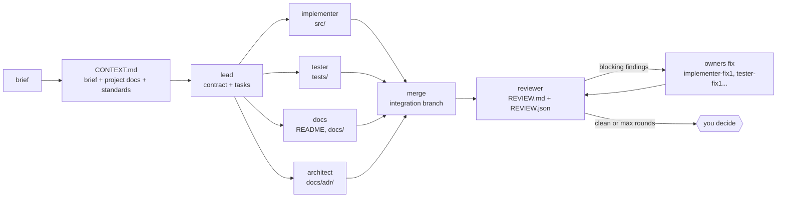

<div align="center">

# claude-orchestrator

**Run a feature through 5 parallel Claude agents, each isolated in its own git worktree, and watch them work on a live map in your terminal.**


[Install](#install) · [Quick start](#quick-start) · [How it works](#how-it-works) · [Commands](#commands) · [Customize](#customize) · [Português](README.pt-BR.md)

</div>

---

## Why

One agent doing everything works in sequence and its context fills up. Splitting a feature across specialists that work **at the same time, without touching each other's files**, is faster and keeps each context small. This is the *orchestrator-worker* pattern [described by Anthropic](https://www.anthropic.com/engineering/multi-agent-research-system), applied to building features:

- a **lead** writes a contract (stack, file layout, interfaces) and one task per specialist;
- **implementer, tester, docs and architect** run in parallel, each in a separate git worktree and branch, each owning different files;
- results are merged into an integration branch and a **reviewer** audits the merged code;
- blocking findings go **back to the agent that owns the file**, which fixes them, and the reviewer checks again (up to 2 rounds);
- you decide what happens next. Nothing is merged, pushed or deleted without your say.

> **Honest note:** multi-agent only pays off when a feature splits into independent parts. For a bug fix or a one-file tweak, a normal Claude session is cheaper and faster. The `/orch` skill refuses small tasks on purpose.

## Install

Requirements: `python3` 3.9+, `git`, and the [`claude` CLI](https://claude.com/claude-code) (only for real runs; `--dry-run` works without it).

```sh
git clone git@github.com:FernandoHaeser/claude-orchestrator.git ~/github/claude-orchestrator
~/github/claude-orchestrator/install.sh
orch doctor
```

The installer creates a private `.venv` (installs `rich`), puts `orch` in `~/.local/bin`, and links the skill to `~/.claude/skills/orch`. Restart Claude Code once so `/orch` shows up. Use `./install.sh --no-skill` to skip the skill, `./uninstall.sh` to remove it. Update with `git pull`.

If `orch doctor` says `orch` is not on your PATH:

```sh
echo 'export PATH="$HOME/.local/bin:$PATH"' >> ~/.zshrc
```

## Quick start

**1. See it work, free (simulation):**

```sh
cd ~/any-git-repo
orch run "demo" --detach --dry-run --speed 1.5 --project .
orch                       # pick the run, press enter
```

**2. Real run from Claude Code:**

```sh
cd ~/your-project          # git repo, clean working tree
claude
```

then type `/orch`.

| Step | What happens |
|---|---|
| 1. Interview | Claude reads your `CLAUDE.md`/README and asks only what it cannot infer: goal, constraints, out of scope, quality bar. |
| 2. Brief | Writes `<project>/.orch/brief.md`. |
| 3. Launch | Starts the run **detached** and opens a terminal window with the live map. |
| 4. Report | When finished, Claude reads `SUMMARY.md` and `REVIEW.md` and gives you a short verdict. |
| 5. Decide | Claude asks: merge, push/PR, keep for manual review, fix findings first, or discard. |
| 6. Clean up | `orch cleanup` removes the temporary worktrees and branches. |

**3. Real run without Claude (plain CLI):**

```sh
orch run "Add invoice export (CSV + PDF)" --detach --project .
orch watch
```

## How it works



| Design choice | Reason |
|---|---|
| **Contract first** | Parallel agents cannot see each other's work. The contract (interfaces, files, commands) is what keeps them compatible. |
| **One git worktree per agent** | Own folder and branch, so nobody overwrites anybody. |
| **Strict file ownership** | `src/`, `tests/`, docs and ADRs belong to one role each, so merges do not conflict. |
| **Reviewer runs second** | Review needs finished code; it cannot be parallelized. |
| **Review → fix loop** | Findings are routed by file ownership (`src/`→implementer, `tests/`→tester, `docs/`→docs, `docs/adr/`→architect). Only `blocker`/`high`/`medium` trigger a round; `--fix-rounds` caps it (default 2, `0` disables). Anything still open is reported, never hidden. |
| **Least-privilege tools** | Each role gets only the tools it needs (architect and docs get no `Bash`). |
| **Budget cap** | `--budget` (default US$ 2) per agent. |
| **Your branch is never touched** | Everything lands on `orch/<run>/integration`. |

### The map

Zabbix-style topology: nodes are agents, links are colored by state.

| Color | Meaning |
|---|---|
| gray | queued |
| yellow, dashed and blinking | running |
| green | done |
| red | failed |

The label on each link is that agent's cost so far. When a run finishes, `orch watch` also shows the per-agent table:


### Every session in one place

Runs are detached processes that write their state to disk, so closing the window stops nothing and **any terminal** can see **every run**, across all your projects. Run `orch` for a `/resume`-style picker:


## Commands

| Command | What it does |
|---|---|
| `orch` | Interactive picker of all sessions, live. `↑/↓` move, `enter` attach, `s` summary, `x` stop, `c` clean, `q` quit. |
| `orch run "brief" [opts]` | Start a run. Brief can be text, a file path, or `-` for stdin. Add `--detach` to run in the background. |
| `orch ls [-a]` | List runs (active plus recent; `-a` for all). |
| `orch watch [id]` | Live map of a run. Default: newest active. |
| `orch show [id]` | Final `SUMMARY.md` and `REVIEW.md`. |
| `orch kill [id]` | Stop a run (SIGTERM to its process group). |
| `orch cleanup [id]` | Remove a run's worktrees and `orch/<id>/*` branches. |
| `orch clean` | Forget finished runs older than 24h. |
| `orch doctor` | Check the install. |

`id` is any prefix of the run id, e.g. `orch watch 20261007-14`.

**Run options:** `--project <repo>` (default `.`), `--model sonnet` (workers), `--lead-model opus`, `--budget 2` (USD per agent), `--fix-rounds 2`, `--view map|table|both`, `--dry-run`, `--speed <s>`, `--detach`.

## What gets written

```
<your-project>/.orch/                     (hidden from git via .git/info/exclude)
├── brief.md                              written by /orch
└── runs/<run-id>/
    ├── CONTEXT.md                        shared context for every agent
    ├── plan.json                         contract + tasks from the lead
    ├── state.json                        live state read by the orch CLI
    ├── agents/*.jsonl                    raw event log of each agent
    ├── SUMMARY.md                        per-agent report and cost
    └── wt/<role>/                        git worktree of each agent
~/.local/state/claude-orchestrator/runs/  global registry (override: ORCH_STATE_HOME)
```

The orchestrator commits only on its own ephemeral `orch/*` branches (author `orchestrator`), just to be able to merge them.

## Customize

| File | Effect |
|---|---|
| [`orch/standards.md`](orch/standards.md) | Engineering standards injected into every agent: clean code, scalability, security, tests, docs. Stack-agnostic. |
| [`orch/roles/*.md`](orch/roles) | Prompt, allowed tools and file ownership per role. |
| [`skill/orch/SKILL.md`](skill/orch/SKILL.md) | The `/orch` interview, launch and decision flow. |

A project's own `CLAUDE.md` and README are added to the agents' context and take precedence over `standards.md`.

## Limits and status

- Real mode (`claude -p`) is young. Validate with a small feature first. Cost is up to US$ 2 per agent, 6 agents.
- Agents branch from `HEAD`: **uncommitted work is invisible to them** (the orchestrator warns).
- Hooks and plugins from your `~/.claude` may also run inside the workers.
- On merge conflict the agent is skipped and listed in `SUMMARY.md` for manual resolution.
- The live window opens in the terminal you are using (tmux split, Warp, Terminal.app, iTerm2), once per run. Any other terminal: nothing is opened and the `orch watch <id>` command is printed instead.

## Roadmap

- [ ] Lead chooses the roles per feature type (front, API, data, infra) instead of the fixed five
- [x] Fix loop: reviewer → owners fix → re-review (max 2 rounds)
- [ ] Tester also runs after the merge, against the real implementation
- [ ] Interactive finish prompt in the CLI (merge / keep / discard)
- [ ] Auto-open for Ghostty, WezTerm and kitty

## Regenerating the screenshots

The images in `docs/img` are rendered by the real code, not mocked up by hand:

```sh
.venv/bin/python docs/gen_screenshots.py
```

## Credits

Pattern: [How we built our multi-agent research system](https://www.anthropic.com/engineering/multi-agent-research-system) (Anthropic). Terminal UI: [rich](https://github.com/Textualize/rich).
