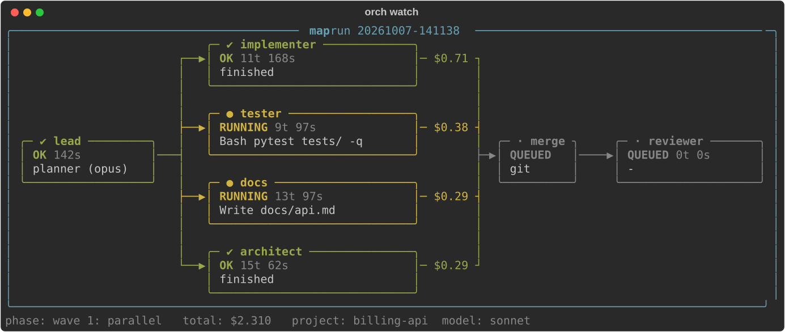
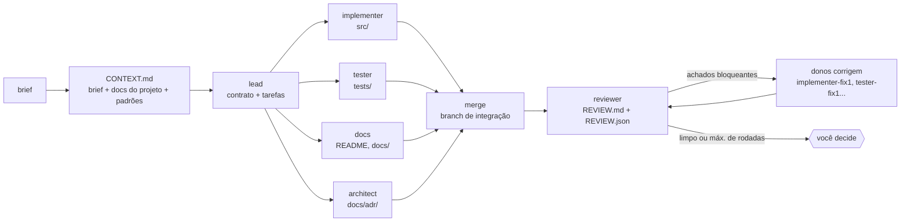
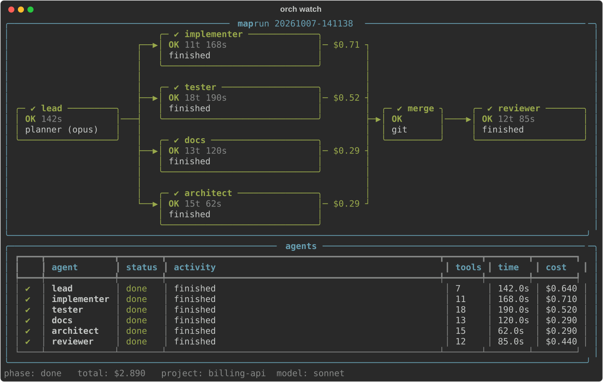
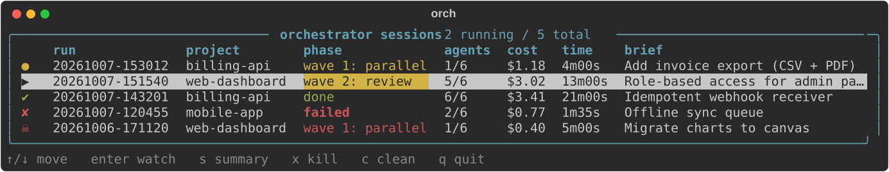

<div align="center">

# claude-orchestrator

**Rode uma feature com 5 agentes Claude em paralelo, cada um isolado no seu git worktree, e acompanhe tudo num mapa ao vivo no terminal.**




[Instalar](#instalar) · [Início rápido](#início-rápido) · [Como funciona](#como-funciona) · [Comandos](#comandos) · [Personalizar](#personalizar) · [English](README.md)

</div>

---

## Por quê

Um agente só trabalha em sequência e o contexto dele enche. Dividir a feature entre especialistas que trabalham **ao mesmo tempo, sem mexer nos arquivos uns dos outros**, é mais rápido e mantém cada contexto pequeno. É o padrão *orchestrator-worker* [descrito pela Anthropic](https://www.anthropic.com/engineering/multi-agent-research-system), aplicado a construir features:

- um **lead** escreve um contrato (stack, estrutura de arquivos, interfaces) e uma tarefa por especialista;
- **implementer, tester, docs e architect** rodam em paralelo, cada um num worktree e branch separados, cada um dono de arquivos diferentes;
- os resultados são juntados numa branch de integração e um **reviewer** audita o código já mergeado;
- os achados bloqueantes **voltam para o agente dono do arquivo**, que corrige, e o reviewer confere de novo (até 2 rodadas);
- você decide o próximo passo. Nada é mergeado, enviado ou apagado sem você mandar.

> **Aviso honesto:** multiagente só compensa quando a feature se divide em partes independentes. Para bug ou ajuste de um arquivo, uma sessão normal é mais barata e rápida. A skill `/orch` recusa tarefas pequenas de propósito.

## Instalar

Requisitos: `python3` 3.9+, `git` e o [CLI `claude`](https://claude.com/claude-code) (só para runs reais; `--dry-run` funciona sem ele).

```sh
git clone git@github.com:FernandoHaeser/claude-orchestrator.git ~/github/claude-orchestrator
~/github/claude-orchestrator/install.sh
orch doctor
```

O instalador cria um `.venv` privado (instala o `rich`), coloca `orch` em `~/.local/bin` e liga a skill em `~/.claude/skills/orch`. Reinicie o Claude Code uma vez para o `/orch` aparecer. `./install.sh --no-skill` pula a skill, `./uninstall.sh` remove tudo. Atualize com `git pull`.

Se o `orch doctor` disser que `orch` não está no PATH:

```sh
echo 'export PATH="$HOME/.local/bin:$PATH"' >> ~/.zshrc
```

## Início rápido

**1. Ver funcionando, de graça (simulação):**

```sh
cd ~/qualquer-repo-git
orch run "demo" --detach --dry-run --speed 1.5 --project .
orch                       # escolha a run e aperte enter
```

**2. Run real pelo Claude Code:**

```sh
cd ~/seu-projeto          # repo git com a árvore limpa
claude
```

e digite `/orch`.

| Passo | O que acontece |
|---|---|
| 1. Entrevista | O Claude lê seu `CLAUDE.md`/README e pergunta só o que não consegue inferir: objetivo, restrições, fora de escopo, nível de qualidade. |
| 2. Brief | Grava `<projeto>/.orch/brief.md`. |
| 3. Lançamento | Inicia a run **desacoplada** e abre uma janela de terminal com o mapa ao vivo. |
| 4. Relatório | Ao terminar, o Claude lê `SUMMARY.md` e `REVIEW.md` e dá um veredito curto. |
| 5. Decisão | O Claude pergunta: merge, push/PR, manter para revisão manual, corrigir os achados antes, ou descartar. |
| 6. Limpeza | `orch cleanup` remove os worktrees e branches temporários. |

**3. Run real sem o Claude (CLI puro):**

```sh
orch run "Exportação de faturas (CSV + PDF)" --detach --project .
orch watch
```

## Como funciona



| Decisão de design | Motivo |
|---|---|
| **Contrato primeiro** | Agentes paralelos não veem o trabalho um do outro. O contrato (interfaces, arquivos, comandos) é o que os mantém compatíveis. |
| **Um git worktree por agente** | Pasta e branch próprias: ninguém sobrescreve ninguém. |
| **Dono de arquivos por papel** | `src/`, `tests/`, docs e ADRs pertencem a um papel cada, então o merge não conflita. |
| **Reviewer roda depois** | Revisão precisa do código pronto; não dá para paralelizar. |
| **Loop review → correção** | Os achados são roteados pelo dono do arquivo (`src/`→implementer, `tests/`→tester, `docs/`→docs, `docs/adr/`→architect). Só `blocker`/`high`/`medium` abrem uma rodada; `--fix-rounds` limita (padrão 2, `0` desliga). O que sobrar é reportado, nunca escondido. |
| **Ferramentas mínimas** | Cada papel recebe só o que precisa (architect e docs não têm `Bash`). |
| **Teto de custo** | `--budget` (padrão US$ 2) por agente. |
| **Sua branch nunca é tocada** | Tudo vai para `orch/<run>/integration`. |

### O mapa

Topologia estilo Zabbix: os nós são os agentes e os links mudam de cor conforme o estado.

| Cor | Significado |
|---|---|
| cinza | aguardando |
| amarelo, tracejado e piscando | rodando |
| verde | concluído |
| vermelho | falhou |

O rótulo de cada link é o custo acumulado daquele agente. Quando a run termina, `orch watch` também mostra a tabela por agente:



### Todas as sessões num lugar só

As runs são processos desacoplados que gravam o estado em disco: fechar a janela não para nada e **qualquer terminal** enxerga **todas as runs**, de todos os projetos. Rode `orch` para um seletor no estilo `/resume`:



## Comandos

| Comando | O que faz |
|---|---|
| `orch` | Seletor interativo de todas as sessões, ao vivo. `↑/↓` move, `enter` abre, `s` resumo, `x` para, `c` limpa, `q` sai. |
| `orch run "brief" [opções]` | Inicia uma run. O brief pode ser texto, caminho de arquivo ou `-` (stdin). `--detach` roda em segundo plano. |
| `orch ls [-a]` | Lista as runs (ativas mais recentes; `-a` para todas). |
| `orch watch [id]` | Mapa ao vivo de uma run. Padrão: a ativa mais recente. |
| `orch show [id]` | `SUMMARY.md` e `REVIEW.md` finais. |
| `orch kill [id]` | Para uma run (SIGTERM no grupo de processos). |
| `orch cleanup [id]` | Remove os worktrees e as branches `orch/<id>/*` de uma run. |
| `orch clean` | Esquece runs finalizadas há mais de 24h. |
| `orch doctor` | Confere a instalação. |

`id` é qualquer prefixo do id da run, por exemplo `orch watch 20261007-14`.

**Opções do run:** `--project <repo>` (padrão `.`), `--model sonnet` (workers), `--lead-model opus`, `--budget 2` (US$ por agente), `--fix-rounds 2`, `--view map|table|both`, `--dry-run`, `--speed <s>`, `--detach`.

## O que é gravado

```
<seu-projeto>/.orch/                      (escondido do git via .git/info/exclude)
├── brief.md                              escrito pelo /orch
└── runs/<run-id>/
    ├── CONTEXT.md                        contexto compartilhado por todos
    ├── plan.json                         contrato + tarefas do lead
    ├── state.json                        estado ao vivo lido pelo CLI
    ├── agents/*.jsonl                    log bruto de cada agente
    ├── SUMMARY.md                        relatório e custo por agente
    └── wt/<papel>/                       git worktree de cada agente
~/.local/state/claude-orchestrator/runs/  registro global (altere com ORCH_STATE_HOME)
```

O orquestrador só faz commits nas próprias branches efêmeras `orch/*` (autor `orchestrator`), apenas para conseguir mergeá-las.

## Personalizar

| Arquivo | Efeito |
|---|---|
| [`orch/standards.md`](orch/standards.md) | Padrões de engenharia injetados em todos os agentes: clean code, escala, segurança, testes, docs. Independente de stack. |
| [`orch/roles/*.md`](orch/roles) | Prompt, ferramentas permitidas e arquivos de cada papel. |
| [`skill/orch/SKILL.md`](skill/orch/SKILL.md) | A entrevista, o lançamento e a decisão final do `/orch`. |

O `CLAUDE.md` e o README do próprio projeto entram no contexto dos agentes e têm precedência sobre o `standards.md`.

## Limites e status

- O modo real (`claude -p`) é novo. Valide com uma feature pequena primeiro. O custo chega a US$ 2 por agente, em 6 agentes.
- Os agentes partem do `HEAD`: **trabalho não commitado é invisível para eles** (o orquestrador avisa).
- Hooks e plugins do seu `~/.claude` também podem rodar dentro dos workers.
- Em conflito de merge, o agente é pulado e listado no `SUMMARY.md` para resolução manual.
- A janela ao vivo abre no terminal que você está usando (split do tmux, Warp, Terminal.app, iTerm2), uma vez por run. Em qualquer outro terminal, nada é aberto e o comando `orch watch <id>` é mostrado.

## Roadmap

- [ ] O lead escolhe os papéis por tipo de feature (front, API, dados, infra) em vez dos cinco fixos
- [x] Loop de correção: reviewer → donos corrigem → nova revisão (no máximo 2 rodadas)
- [ ] Tester também roda depois do merge, contra a implementação real
- [ ] Pergunta final interativa no CLI (merge / manter / descartar)
- [ ] Abertura automática no Ghostty, WezTerm e kitty

## Regenerar os prints

As imagens em `docs/img` são renderizadas pelo código real, não desenhadas à mão:

```sh
.venv/bin/python docs/gen_screenshots.py
```

## Créditos

Padrão: [How we built our multi-agent research system](https://www.anthropic.com/engineering/multi-agent-research-system) (Anthropic). Interface de terminal: [rich](https://github.com/Textualize/rich).
